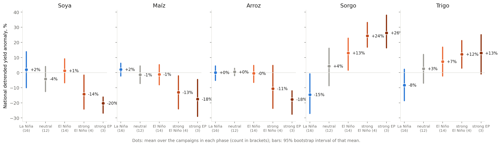
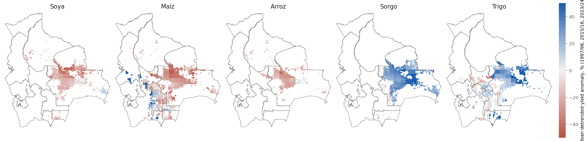
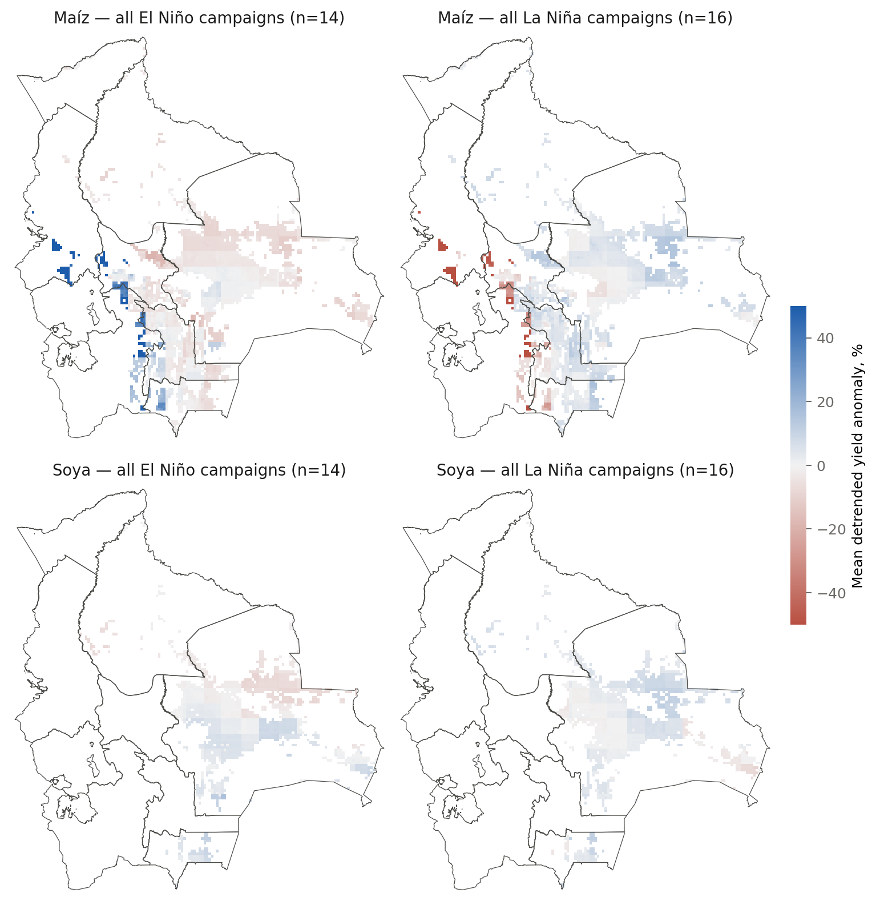

# Phase 3 — Historical ENSO assessment, Bolivia 1983/84–2024/25

Draft 2026-10-05. Reference run `20261004-2232_v8_calib-round2` (Tapiti, Phase 2 calibration). Companion to `PLAN.md` §8. Tables are generated by `analysis/phase3_report.py` from `derived/phase3/`; figures in `derived/phase3/figures/`.

## 1. What this is and is not

Two lines of evidence, kept separate as the plan requires. **(b) Mechanistic:** Tapiti simulations of every campaign 1983/84–2024/25 under observed NASA POWER weather, with everything but weather held constant, composited by ENSO phase — differences between phases are attributable to climate alone. **(a) Statistical:** observed yields (INE departmental series) and observed weather (SENAMHI stations) against the same ENSO classification — no crop model involved, but confounded by prices, area, technology and policy. Where the two agree the finding is robust; where they diverge the gap is informative. Anomalies are **detrended** (linear, per series) and expressed in % of the trend mean; intervals are 95% bootstrap intervals of the phase mean (years resampled within phase). `**` marks a phase whose difference from neutral years has a 95% interval excluding zero.

## 2. ENSO classification of the 42 campaigns

DJF ONI (CPC, ERSSTv5) labelled by the campaign's sowing year; ±0.5 °C threshold, strong ≥ 1.5. The eastern-Pacific refinement uses the DJF Niño-1+2 anomaly: **strong EP analogues** are strong El Niño campaigns with Niño-1+2 ≥ +1.0 °C — 1997/98, 2015/16 and 2023/24. 1982/83, the other benchmark, pre-dates the simulated record (weather from 1981, first sowing 1983).

| Category | Campaigns | Which |
|---|---|---|
| strong El Niño | 4 | 1991/92, 1997/98, 2015/16, 2023/24 |
| moderate El Niño | 2 | 1986/87, 2009/10 |
| weak El Niño | 8 | 1987/88, 1994/95, 2002/03, 2004/05, 2006/07, 2014/15, 2018/19, 2019/20 |
| neutral | 12 | 1985/86, 1989/90, 1990/91, 1992/93, 1993/94, 1996/97, 2001/02, 2003/04, 2012/13, 2013/14, 2016/17, 2024/25 |
| weak La Niña | 10 | 1983/84, 1995/96, 2000/01, 2005/06, 2008/09, 2011/12, 2017/18, 2020/21, 2021/22, 2022/23 |
| moderate La Niña | 3 | 1984/85, 1999/00, 2010/11 |
| strong La Niña | 3 | 1988/89, 1998/99, 2007/08 |

Strong El Niño campaigns and their eastern-Pacific weighting (Niño-1+2 minus Niño-3.4, DJF): 1991/92 ONI +1.5, N1+2 +0.6, EP−CP -1.1; 1997/98 ONI +2.2, N1+2 +3.5, EP−CP +1.2; 2015/16 ONI +2.5, N1+2 +1.8, EP−CP -0.7; 2023/24 ONI +1.8, N1+2 +1.3, EP−CP -0.5. 1991/92 is a central-Pacific event (N1+2 +0.6) and behaves differently below. The 2026/27 event is forecast at Niño-1+2 ≈ +3.4 °C, i.e. 1997/98-like.

## 3. Is the ENSO signal in the weather? (check before compositing yields)

### 3.1 Observed: SENAMHI station rainfall, Nov–Mar totals

29 stations with monthly precipitation ({'valleys': 11, 'lowland': 10, 'altiplano': 8}), records 1970–2009, so the composites cover campaigns 1983/84–2008/09 only and the only strong-EP analogue inside the record is **1997/98**. Anomalies are % of each station's own Nov–Mar mean, averaged across stations.

| Zone | El Niño (8) | La Niña (10) | Neutral (8) | Strong El Niño 1991/92 + 1997/98 | 1997/98 |
|---|---|---|---|---|---|
| Bolivia | -4% | +6% | -3% | -9% | -17% |
| lowland | +2% | +6% | -6% | +5% | -9% |
| valleys | -5% | +5% | -2% | -12% | -16% |
| altiplano | -11% | +9% | -1% | -27% | -35% |

The classic picture is present in the observations: El Niño campaigns are drier in the Altiplano (-11%, 95% CI [-19, -3]) and valleys (-5%, [-10, -0]) and not drier in the lowlands; La Niña is wetter everywhere. 1997/98 alone was −35% in the Altiplano, −16% in the valleys, −9% in the lowlands. Potosí stations show the largest El Niño deficit (−15% all events, −42% in 1997/98).

### 3.2 Model input: NASA POWER, area-weighted over the modelled cells

Nov–Mar rainfall anomaly (% of mean) and Tmax anomaly (°C), 1983/84–2024/25:

| Zone | El Niño (14) | La Niña (16) | Neutral (12) | Strong El Niño (4) | Strong EP analogues (3) | Tmax: El Niño | La Niña | Strong EP |
|---|---|---|---|---|---|---|---|---|
| all | -1% | +1% | +0% | -5% | -17% | +0.3 | -0.4 | +2.1 |
| lowland | -1% | +1% | -0% | -5% | -17% | +0.3 | -0.4 | +2.1 |
| valleys | -1% | +1% | -0% | -8% | -18% | +0.4 | -0.4 | +1.7 |
| altiplano | -5% | +1% | +4% | -19% | -19% | +0.5 | -0.4 | +1.6 |

Two things follow. First, **the reanalysis under-represents the observed El Niño drying of the Altiplano** (−5% in POWER vs −11% at the stations for all El Niño campaigns), which is the expected weakness of a 0.5° product in the Andes (PLAN §10) and means Altiplano results below are conservative at best. Second, in both datasets **the signal is carried by the strong eastern-Pacific events, not by El Niño as a class**: the all-El-Niño composite is within a few percent of neutral, while 1997/98, 2015/16 and 2023/24 bring 17–19% less rain and 1.6–2.1 °C hotter days in every zone. The 2026/27 event belongs to that class.

## 4. Simulated yield anomalies by ENSO phase (mechanistic line)

National, area-weighted, detrended; `**` = difference from neutral years distinguishable from zero at 95%.

| Crop | La Niña | neutral | El Niño | strong El Niño (ONI≥1.5) | strong EP analogues 1997/2015/2023 |
|---|---|---|---|---|---|
| Soya | +2% [-10, +14] | -4% [-13, +4] | +1% [-7, +9] | -14% [-24, -2] | -20% [-27, -16]** |
| Maíz | +2% [-2, +6] | -1% [-7, +4] | -1% [-8, +5] | -13% [-24, -2] | -18% [-29, -5]** |
| Arroz | +0% [-5, +4] | +0% [-2, +3] | -0% [-7, +5] | -11% [-24, +5] | -18% [-28, -12]** |
| Sorgo | -15% [-27, -1] | +4% [-9, +16] | +13% [+2, +23] | +24% [+17, +33]** | +26% [+16, +38]** |
| Trigo | -8% [-19, +2] | +3% [-7, +12] | +7% [-2, +17] | +12% [+3, +21] | +13% [-1, +25] |

**Reading.** El Niño as a class does nothing to the verano crops (soya, maíz, arroz within ±2% of neutral). The strong eastern-Pacific analogues are a different matter: **soya -20%, maíz -18%, arroz -18%**, each with an interval excluding zero, and each individual event negative. The **invierno crops gain**: sorgo +26% and trigo +13%. Note the timing: a campaign labelled by sowing year *y* pairs the invierno sown in April–June of *y* with the El Niño that peaks the following DJF, so this is the **developing-El Niño winter** (invierno 1997, 2015, 2023), which is wetter in the eastern lowlands, not the winter after the peak; symmetrically, the developing-La Niña winter costs sorgo -15% (interval excluding zero) and trigo -8%. That asymmetry — verano losers after the peak, invierno winners during the build-up — is the central finding of this phase and it matches the INE record where the two overlap (§5). For 2026/27 it means the invierno 2026 crops (already harvested) are the beneficiaries and the verano 2026/27 crops the exposed ones.

### 4.1 By zone

| Crop | Zone | kha | El Niño | La Niña | Strong EP analogues | Worst campaign |
|---|---|---|---|---|---|---|
| Maíz | altiplano | 78 | +12% [+6, +19]** | -8% [-16, -1] | +18% [+3, +28]** | 2015 (+3%) |
| Maíz | lowland | 261 | -4% [-13, +5] | +4% [-3, +10] | -26% [-37, -13]** | 2015 (-37%) |
| Maíz | valleys | 79 | -2% [-10, +5] | +4% [-2, +10] | -12% [-24, +6] | 2015 (-24%) |
| Arroz | lowland | 161 | -0% [-7, +5] | +0% [-5, +5] | -18% [-28, -13]** | 1997 (-28%) |
| Arroz | valleys | 5 | -1% [-5, +2] | -2% [-7, +3] | -5% [-24, +9] | 2015 (-24%) |
| Soya | lowland | 1378 | +1% [-7, +9] | +2% [-10, +14] | -20% [-27, -16]** | 2015 (-27%) |
| Soya | valleys | 9 | +4% [-7, +15] | +3% [-9, +16] | -14% [-29, -6] | 2015 (-29%) |
| Sorgo | altiplano | 1 | +20% [-12, +55] | -22% [-50, +10] | +34% [-37, +134] | 2015 (-37%) |
| Sorgo | lowland | 418 | +14% [+2, +25] | -16% [-30, -0]** | +29% [+19, +41]** | 1997 (+19%) |
| Sorgo | valleys | 23 | +2% [-5, +7] | +1% [-4, +5] | -6% [-21, +9] | 2015 (-21%) |
| Trigo | altiplano | 40 | -4% [-9, +0] | +2% [-4, +7] | -5% [-15, +3] | 2015 (-15%) |
| Trigo | lowland | 116 | +13% [-3, +30] | -15% [-32, +3] | +24% [-3, +53] | 2023 (-3%) |
| Trigo | valleys | 26 | +3% [-1, +7]** | -1% [-5, +3] | +0% [-12, +8] | 2015 (-12%) |

Lowland maíz and soya carry the strong-EP loss (−27% and −20%); valley maíz −12%. **Altiplano maíz goes the other way (+18% in strong EP years, +12% in all El Niño years)**: in the model the Altiplano crop is cold-limited, so a warmer El Niño summer with fewer frosts outweighs the (under-represented) rainfall deficit. This is where the mechanistic and observed lines diverge most and where the model is least trustworthy (35% of simulated Altiplano maize seasons fail; the reanalysis misses half of the observed drying). Treat the Altiplano maize sign as unresolved, not as a result.

## 5. The analogue events, one by one

Simulated national detrended anomaly (%) and, where INE's departmental series exist (2012–2024), the observed detrended anomaly. 1982/83 is outside the simulated record.

| Crop | 1991/92 (CP, ONI +1.5) | 1997/98 (EP, +2.2) | 2009/10 (CP, +1.5) | 2015/16 (EP, +2.5) | 2015/16 observed | 2023/24 (EP, +1.8) | 2023/24 observed |
|---|---|---|---|---|---|---|---|
| Soya (verano) | +4 | -18 | +14 | -27 | +9 | -16 | -15 |
| Maíz (verano) | +0 | -19 | +23 | -29 | -1 | -5 | -14 |
| Arroz (verano) | +11 | -28 | +3 | -13 | -14 | -12 | -29 |
| Sorgo (invierno) | +18 | +16 | +10 | +24 | +16 | +38 | +43 |
| Trigo (invierno) | +10 | +15 | +16 | +25 | -0 | -1 | +17 |

- **1997/98** — the strongest eastern-Pacific event in the record (Niño-1+2 +3.5 °C). POWER: −17% rain, +2 °C Tmax across zones; SENAMHI stations: −35% Altiplano, −16% valleys. Simulated maíz −19%, arroz −28%, soya −18%; invierno sorgo +16%, trigo +15%. No INE departmental series for validation.
- **2015/16** — ONI +2.5, Niño-1+2 +1.8. Simulated maíz −29% (the worst maize campaign of the 42), soya −27%, arroz −13%; sorgo +24%, trigo +25%. Observed (INE, detrended): soya verano +9, maíz -1, arroz -14; sorgo invierno +16, trigo invierno -0. The model and the record agree on arroz and sorgo and on the sign for maíz; **they disagree on soya**, where the record shows no loss — consistent with §7.3c of the plan (the model loves rainfall, Santa Cruz soya does not).
- **2023/24** — ONI +1.8, Niño-1+2 +1.3. Simulated soya −16%, arroz −12%, maíz −5%; sorgo +38%. Observed: soya -15, arroz -29, maíz -14; sorgo invierno +43, trigo +17. **Close agreement on every crop** — the best-validated event, and the most recent.
- **1991/92 and 2009/10 (central-Pacific, ONI +1.5)** — simulated verano crops *gain* (maíz +0/+23, soya +4/+14) and invierno crops gain too. A CP El Niño is not a drought year for Bolivia in either the model or the weather. This is why the composite must be stratified by Niño-1+2: the 2026/27 event is EP.
- **La Niña for contrast, 2010/11 (ONI −1.3)**: simulated soya and sorgo both at their record lows (§7.0 of the plan); the Santa Cruz drought of that winter is in the record.

## 6. Observed yields by phase (statistical line), 2012–2024 only

INE departmental series exist only from 2012; thirteen campaigns, five El Niño (two strong), four La Niña, three to four neutral. Means of detrended national anomalies (%):

| Crop, season | El Niño (5) | La Niña (4) | Neutral (3–4) |
|---|---|---|---|
| Maíz verano | -5 | +9 | -3 |
| Arroz verano | -5 | +10 | -5 |
| Soya verano | -2 | +6 | -5 |
| Sorgo invierno | +17 | -0 | -20 |
| Trigo invierno | +5 | +15 | -20 |

Thirteen years cannot support phase composites; the per-event table in §5 is the honest use of this record. Its one robust message is the **invierno gain in the developing-El Niño winter**: observed sorgo invierno was +16% in 2015 and +43% in 2023, trigo invierno +17% in 2023 — the same asymmetry the model produces from weather alone.

## 7. What is distinguishable from zero, and what is not

Distinguishable from neutral at 95% (national, bootstrap over years): Maíz under strong EP analogues 1997/2015/2023 (-18%, n=3); Arroz under strong EP analogues 1997/2015/2023 (-18%, n=3); Soya under strong EP analogues 1997/2015/2023 (-20%, n=3); Sorgo under strong EP analogues 1997/2015/2023 (+26%, n=3); Sorgo under strong El Niño (ONI≥1.5) (+24%, n=4).

**Not** distinguishable: every verano crop under El Niño or La Niña as a class; trigo under any phase except its La Niña loss being borderline; everything in the Altiplano. The strong-EP composites rest on **three events** — their intervals are narrow because the three agree, not because three is many. Report them as "in the three eastern-Pacific El Niño campaigns since 1983", never as a climatological expectation.

## 8. Caveats that travel with these numbers

- **Soya** (1.4 Mha): the model's weather response is wrong in a specific way — it gains from rainfall and wet days where the record is indifferent or loses (PLAN §7.3c). Its strong-EP loss (−20%) comes through heat and dry spells, which it does get right, so the sign is defensible; the magnitude is not, and 2015/16 shows the record can disagree. The model's −1.25%/yr soya trend was removed before compositing.
- **Altiplano**: reanalysis rainfall misses half the observed El Niño deficit; Altiplano maize fails in a third of simulated seasons; potato and quinoa are absent. The highland drought story has to come from the station record and INE, not from this model.
- **Levels vs anomalies**: Phase 2 calibrated levels; anomaly skill against INE is 0.66–0.76 for arroz/sorgo/trigo and 0.28–0.42 for soya/maíz over twelve years.
- **No area response, no floods/hail/frost damage, no pests** (PLAN §10). The excess-rain channel that matters for lowland soya in El Niño years is outside the model.
- **1982/83 is not simulated**; the station record shows it, the model cannot.

## 9. Implication for 2026/27 (preview of Phase 4)

If 2026/27 behaves like the three eastern-Pacific analogues, the model's expectation is a **15–20% national loss in the verano grains and oilseed (maíz, arroz, soya), concentrated in the Santa Cruz plain, while the invierno 2026 sorgo and trigo, grown during the El Niño build-up, should have done well** (Phase 4 confirms this with observed weather), with the Altiplano unresolved by this tool. Phase 4 turns this into a season-specific estimate by driving the 2026/27 calendar with the analogue years' weather and with the C3S seasonal forecasts.
