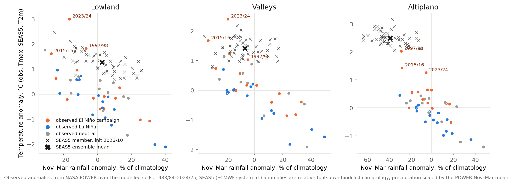

# Phase 4 — The 2026/27 campaign: analogue ensemble and forecast conditioning

Draft 2026-10-08. Built by `analysis/phase4_*.py` from the Phase 2 reference run's inputs; tables in `derived/phase4/`, figures in `derived/phase4/figures/`. Companion to `PLAN.md` §9 and the Phase 3 report.

## 1. Method

**Analogue ensemble.** The 2026/27 campaign is simulated 42 times with Tapiti, once per past campaign 1983/84–2024/25: observed NASA POWER weather for 1 January 2025 – 1 October 2026 (the real pre-season to date), then the weather of the analogue campaign from 2 October 2026 onward, mapped by calendar date through December 2027. The campaign's invierno crops (Santa Cruz sorgo and trigo, sown April–June 2026) fall entirely inside the observed part of the splice, so they are identical across members: for them §4 is a **nowcast of the 2026 season already harvested**, not an outlook. The verano crops and the highland (verano-sown) trigo are the exposed part. Management, soils and cultivars are the Phase 2 reference set; CO₂ is the 2026/27 value. Each member is therefore "2026/27 if the rest of the season unfolds like campaign A". Results are reported as % of the mean over all 42 analogues, i.e. relative to the unconditional expectation for 2026/27 under identical management, which removes the level bias discussed in Phase 2.

**Conditioning.** Three ways of reading the ensemble, from weakest to strongest assumption: (i) all analogues (climatology); (ii) El Niño analogues only, and within them the three strong eastern-Pacific campaigns Phase 3 identified as the relevant class (1997/98, 2015/16, 2023/24); (iii) **SEAS5-weighted**: each analogue weighted by how closely its observed Nov–Mar anomaly (rainfall % and temperature, by zone) matches the ECMWF SEAS5 system-51 ensemble members initialised 2026-10 (51 members, Gaussian kernel on standardised distance, averaged over members). (iii) uses the actual seasonal forecast without any daily disaggregation of it; the forecast selects and weights real weather histories.

## 2. What the seasonal forecast says (SEAS5, initialised 2026-10, valid Nov 2026 – Mar 2027)

| Zone | Rainfall anomaly, % (member mean) | 10th–90th percentile | T2m anomaly, °C (mean) | 10th–90th |
|---|---|---|---|---|
| lowland | +3 | -13 to +21 | +1.3 | +0.7 to +1.7 |
| valleys | -7 | -18 to +11 | +1.4 | +1.0 to +1.8 |
| altiplano | -37 | -52 to -19 | +2.5 | +2.2 to +2.8 |

The forecast reproduces the strong-EP El Niño pattern of Phase 3: a robust Altiplano rainfall deficit (every member dry), a mild valley deficit, no rainfall signal in the lowlands but a wide spread, and warmth everywhere — the lowland El Niño impact in this forecast would come through heat and dry spells, not through seasonal rainfall total.

**Analogue weights.** The three strong-EP campaigns carry 34% of the weight, all El Niño campaigns 55%, La Niña 19%. Top analogues: 1997/98 (0.20), 2015/16 (0.09), 1993/94 (0.05), 1989/90 (0.04), 2023/24 (0.04), 2022/23 (0.04), 2009/10 (0.04), 2002/03 (0.04).

## 3. Invierno 2026 (sown April–June 2026, observed weather): a nowcast

Phase 3 found that the winter crops sown while an El Niño is building do well; invierno 2026 was exactly that season. Simulated yield under the observed 2026 weather against the Phase 2 hindcast, trend-adjusted to 2026 (identical across ensemble members, member s.d. shown to confirm):

| Crop | Department / zone | kha | 2026 simulated, kg/ha | vs hindcast trend | vs last 10 campaigns | Rank in 43 |
|---|---|---|---|---|---|---|
| Sorgo | Bolivia all | 442 | 2485 (±19) | +58% | +46% | 40 |
| Sorgo | Bolivia lowland | 418 | 2453 (±1) | +62% | +49% | 39 |
| Trigo | Bolivia lowland | 116 | 1822 (±12) | +29% | +14% | 24 |
| Sorgo | Santa Cruz lowland | 418 | 2452 (±0) | +62% | +49% | 39 |
| Trigo | Santa Cruz lowland | 113 | 1787 (±1) | +29% | +13% | 24 |

Invierno 2026 sorgo in Santa Cruz comes out among the best five of the 43 simulated seasons, as the developing-El Niño pattern predicts; this is the part of the 2026/27 campaign that can be checked against INE as soon as the invierno 2026 statistics are published.

**Check against the trade's own numbers (8 October 2026).** INE has not yet published invierno 2026. ANAPO (the Santa Cruz oilseed and wheat producers' association), reported in the Santa Cruz press, closed the campaign with: sorgo 612 kha sown (535 kha in 2025), yields expected at 2.8–3.5 t/ha on 70% of the area to be harvested (Agro Sinergia, 5 Aug 2026); trigo 57 kha, the lowest in three decades, with 'climatic conditions that favoured the crop' and an expected 1.6–1.7 t/ha for 80–90 kt (El Deber, 19 Jul 2026); and 'positive results' for both at the close (La Razón, 4 Oct 2026). Against the INE Santa Cruz invierno series (2015–2024 means: sorgo 2.17, trigo 1.45 t/ha) those expectations are sorgo +29% to +62% and trigo +10% to +17%, the same direction and magnitude as the simulated +49% (sorgo, lowland) and +14% (trigo) versus the last ten campaigns. Two caveats: these are producer-association projections made during harvest, not INE's final survey, and the simulated areas are the fixed MapSPAM 2020 set, so only the yield ratios are comparable, not production.

## 4. Verano 2026/27 national yield outlook, % of the all-analogue mean

Mean of the conditioned set; in brackets the 10th–90th percentile across its members; P(≥10% loss) = share of members (or weight) at or below −10%.

| Crop | all 42 analogues | El Niño analogues | strong EP analogues 1997/2015/2023 | SEAS5-weighted analogues | La Niña analogues |
|---|---|---|---|---|---|
| Soya | -0% [-37, +26], P₁₀ 0.33 | +0% [-36, +26], P₁₀ 0.36 | -30% [-42, -15], P₁₀ 0.67 | -9% [-41, +20], P₁₀ 0.38 | +1% [-35, +29], P₁₀ 0.38 |
| Maíz | -0% [-15, +12], P₁₀ 0.24 | -1% [-18, +12], P₁₀ 0.36 | -22% [-32, -14], P₁₀ 1.00 | -7% [-27, +11], P₁₀ 0.47 | +3% [-11, +13], P₁₀ 0.12 |
| Arroz | +0% [-16, +10], P₁₀ 0.14 | -1% [-17, +12], P₁₀ 0.21 | -20% [-25, -17], P₁₀ 1.00 | -7% [-26, +7], P₁₀ 0.38 | +1% [-13, +10], P₁₀ 0.12 |
| Trigo | +0% [-5, +5], P₁₀ 0.00 | -1% [-3, +2], P₁₀ 0.00 | -3% [-5, -1], P₁₀ 0.00 | -2% [-5, +2], P₁₀ 0.00 | +0% [-4, +6], P₁₀ 0.00 |

Trigo here mixes the Santa Cruz invierno crop (fixed, see §3) with the highland verano crop (exposed); see §5 for the split. Sorgo is omitted: it is an invierno crop in the Santa Cruz plain and belongs to §3.

**Reading.** Under the strong-EP analogues the verano crops lose: soya -30%, maíz -22%, arroz -20%; highland trigo -3% (national, diluted by the fixed Santa Cruz invierno share). The SEAS5-weighted estimate — the one that uses the actual forecast — sits between the El Niño composite and the strong-EP composite: soya -9%, maíz -7%, arroz -7%, with P(≥10% loss) for soya 0.38, maíz 0.47, arroz 0.38. Treat the spread as the result: these are conditional distributions over real seasons, not point forecasts.

## 5. By zone and department (SEAS5-weighted and strong-EP; invierno rows are nowcasts and read ~0 by construction)

**Soya** (department × zone with ≥5 kha):

| Department | Zone | kha | SEAS5-weighted | Strong EP analogues |
|---|---|---|---|---|
| Bolivia | lowland | 1378 | -9% | -30% |
| Santa Cruz | lowland | 1367 | -9% | -31% |
| Bolivia | valleys | 9 | -11% | -32% |
| Santa Cruz | valleys | 7 | -12% | -29% |
| Beni | lowland | 6 | -8% | -18% |
| Tarija | lowland | 6 | -11% | -37% |

**Maíz** (department × zone with ≥5 kha):

| Department | Zone | kha | SEAS5-weighted | Strong EP analogues |
|---|---|---|---|---|
| Bolivia | lowland | 261 | -9% | -33% |
| Santa Cruz | lowland | 203 | -10% | -35% |
| Bolivia | valleys | 79 | -11% | -20% |
| Bolivia | altiplano | 78 | +8% | +23% |
| Chuquisaca | valleys | 45 | -11% | -20% |
| Tarija | lowland | 27 | -9% | -24% |
| Cochabamba | altiplano | 22 | -0% | +8% |
| Potosi | altiplano | 18 | +35% | +91% |
| La Paz | altiplano | 16 | +305% | +586% |
| Tarija | valleys | 16 | -7% | -15% |
| Chuquisaca | altiplano | 14 | +4% | +9% |
| Cochabamba | lowland | 12 | -11% | -16% |
| Santa Cruz | valleys | 9 | -13% | -24% |
| Cochabamba | valleys | 9 | -13% | -22% |
| Beni | lowland | 9 | -6% | -15% |
| Tarija | altiplano | 8 | +12% | +22% |
| Chuquisaca | lowland | 6 | -6% | -16% |

**Arroz** (department × zone with ≥5 kha):

| Department | Zone | kha | SEAS5-weighted | Strong EP analogues |
|---|---|---|---|---|
| Bolivia | lowland | 161 | -7% | -21% |
| Santa Cruz | lowland | 116 | -5% | -25% |
| Beni | lowland | 39 | -9% | -16% |

**Sorgo** (department × zone with ≥5 kha):

| Department | Zone | kha | SEAS5-weighted | Strong EP analogues |
|---|---|---|---|---|
| Bolivia | lowland | 418 | -0% | -0% |
| Santa Cruz | lowland | 418 | -0% | -0% |
| Bolivia | valleys | 23 | -5% | -12% |
| Santa Cruz | valleys | 22 | -5% | -12% |

**Trigo** (department × zone with ≥5 kha):

| Department | Zone | kha | SEAS5-weighted | Strong EP analogues |
|---|---|---|---|---|
| Bolivia | lowland | 116 | -1% | -1% |
| Santa Cruz | lowland | 113 | -0% | -0% |
| Bolivia | altiplano | 40 | -5% | -4% |
| Bolivia | valleys | 26 | -4% | -5% |
| Potosi | altiplano | 17 | -4% | -2% |
| Cochabamba | altiplano | 13 | -7% | -5% |
| Santa Cruz | valleys | 11 | -4% | -9% |
| Chuquisaca | valleys | 9 | -2% | -3% |

## 6. Sowing dates the onset scan chose (median DOY across cells, by analogue class)

| Crop | El Niño analogues | La Niña | Neutral |
|---|---|---|---|
| Soya | 302 | 302 | 300 |
| Maíz | 297 | 300 | 310 |
| Arroz | 305 | 299 | 306 |
| Sorgo | 75 | 75 | 75 |
| Trigo | 151 | 151 | 151 |

The rainfall-onset scan is the channel through which a delayed rainy season moves sowing; a later median under El Niño analogues is that mechanism at work.

## 7. Caveats specific to this estimate

- **It is an outlook conditional on analogue weather, not a prediction of the 2026/27 harvest.** No area response (farmers plant less or switch after a failed onset), no floods, hail, frost damage or pests, no prices. Relative anomalies only; absolute tonnes are not defensible (PLAN §10).
- **Soya**: Phase 2/3 showed the model gains from rainfall and wet days where the record is indifferent or loses; its El Niño loss here comes through heat and dry spells, which the model gets right in sign. The 2015/16 record (observed +9%, simulated −27%) bounds how wrong a single-season soya number can be.
- **Altiplano**: the reanalysis under-represents the observed El Niño drying and the model has no potato or quinoa; the SEAS5 Altiplano deficit (−33%) is the strongest signal in the forecast and this tool cannot translate it into the crops that matter there. Altiplano maize results are unresolved (Phase 3).
- **Three strong-EP analogues** carry most of the conditional signal; the SEAS5 weighting spreads it over more seasons but 40% of the weight still rests on them.
- **Forecast matching is approximate**: SEAS5 anomalies are relative to its own hindcast climatology (precipitation scaled by the POWER mean) and its 2 m temperature is matched to POWER Tmax; the kernel width is not tuned. The weights change with each monthly SEAS5 release — rerun `analysis/phase4_c3s_fetch.py`, `phase4_forecast_weights.py` and `phase4_summarise.py <weights>` on the 8th of each month.
- **Observed-to-date splice**: everything before {SPL} is real; as the season advances the splice date moves forward and the spread narrows. The same pipeline supports monthly updates.

## 8. Phase 5: the ECMWF member ensemble (added 2026-10-14)

A second, forecast-driven estimate now sits beside the analogue sets (PLAN.md §12). Each of the 51 ECMWF members (EC46 to
day ~42, then the October SEAS5, served by Open-Meteo) was bias-adjusted onto each cell's POWER 1991–2020 climatology
(separate Tmax/Tmin shifts, rain and SRAD ratios, monthly, interpolated to the day), spliced onto observed POWER to
2026-10-01, and extended beyond 2027-05-03 with the 1997/98 analogue. DSSAT then ran the 2026/27 campaign under each member
(`runs/phase5/2026-10-14/`, 51 × 9,104 seasons, 0 errors). National yield anomaly, % of the all-analogue mean:

| Crop | SEAS5-weighted analogues | Strong-EP analogues (1997/2015/2023) | ECMWF members: mean | median | p10 | p90 | P(loss ≥ 10 %) | P(loss ≥ 20 %) |
|---|---|---|---|---|---|---|---|---|
| Soya | -9.5 | -30.5 | -17.1 | -13.4 | -42.9 | +3.3 | 0.59 | 0.35 |
| Maíz | -7.0 | -22.5 | -16.0 | -13.9 | -27.0 | -5.5 | 0.75 | 0.33 |
| Arroz | -6.8 | -20.2 | -13.1 | -11.8 | -25.3 | -1.4 | 0.57 | 0.22 |
| Sorgo | -0.3 | -0.8 | -0.9 | -0.7 | -1.9 | -0.1 | 0.00 | 0.00 |
| Trigo | -2.2 | -2.6 | -5.3 | -5.5 | -8.6 | -2.0 | 0.02 | 0.00 |

Reading it: the member mean lands between the SEAS5-weighted analogue set and the strong-EP set for the three lowland
summer crops, and the member spread is wide (soya p10 to p90 spans about 46 points). By zone the members put the Altiplano
drier (NDJFM rain ≈ −23 % vs POWER climatology at sampled points; wheat −23 %, maize +29 % on a cold-limited baseline) and
the lowland warm (season Tmax/Tmin ≈ +1.5 °C over the all-analogue mean, inside the 1997/2015/2023 range).

What the comparison does and does not show. The members carry the model's own forecast for this season, so they are not a
third conditioning of the analogue set; agreement in sign with the strong-EP set is the useful signal. The members cannot be
verified: Open-Meteo serves no hindcasts, so there is no member-level skill estimate for Bolivia, and the analogue sets remain
the primary estimate. A first version with a single mean-temperature shift was 3 to 4 points more negative for soya, maize
and rice purely from a +0.6 °C convention offset and the model's narrower diurnal range (kept under `v1_meanshift/`); the
remaining sensitivity of DSSAT to the bias-adjustment choices is of that order and should be read as part of the uncertainty.
Daily rain structure of the scaled members matches POWER in the lowland (wet-day fraction 0.64 vs 0.61, 8.5 vs 9.0 mm per
wet day) and is somewhat more drizzly in the valleys (0.62 vs 0.53). Figure:
`derived/phase5/2026-10-14/figures/chart_2026_27_members_vs_analogues.png`.
